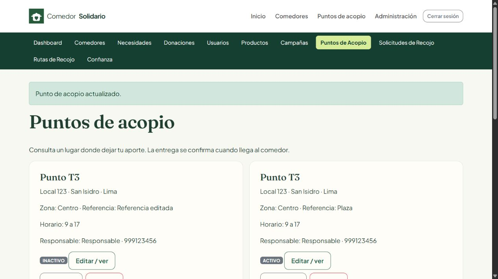

# Verificación T3 — 10 de noviembre de 2026

Revisión de entrega del 11 de noviembre de 2026: se confirmó el registro, configuración e inyección de Spring MVC y su presencia en el WAR. Se completaron el diagrama de base de datos (PlantUML y SVG) y el manual de activación/pruebas posteriores. El nuevo diagrama se validó y generó con PlantUML. No se modificó código de aplicación ni el SQL definitivo en esta revisión; siguen siendo aplicables los resultados funcionales que se detallan abajo. La migración habitual continúa pendiente de ejecución manual por Diego.

## Entorno y protección de los datos

Se comprobó el proyecto real de la rama `diego/nuevas-mejoras`. JDK 25.0.4.1, compilación para Java 21, Maven 3.9.16, NetBeans 31, Tomcat 10.1.60 y MySQL 8.4.10.

La base habitual se consultó exclusivamente para comprobar conexión y estructura. Conserva las seis tablas originales y el esquema anterior a T3. **No se aplicó ninguna migración, ni se insertaron, actualizaron o eliminaron sus datos.** No se editaron `db.properties` ni sus credenciales.

Para las pruebas con escritura se inicializó otra instancia de MySQL, en `127.0.0.1:3308`, con directorio de datos separado y registros ficticios. Se ejecutaron allí el instalador y la migración T3, incluyendo repeticiones de esta última. Tomcat de prueba utilizó el puerto 18080 y las variables de entorno `CS_DB_*` exclusivamente en su proceso.

También se comprobó la acción **Run (F6) de NetBeans** contra Tomcat 10.1 del equipo en el puerto 8080. Ese proceso de Tomcat se inició con las mismas variables que apuntaban a MySQL de pruebas en 3308. NetBeans mostró `BUILD SUCCESS`, aplicación desplegada y arrancada en `/ComedorSolidario`, y abrió `/inicio` en el navegador. No fue una ejecución de T3 sobre la base habitual.

## Resultados

| Comprobación | Resultado |
| --- | --- |
| `mvn clean package` | BUILD SUCCESS; WAR generado; 50 archivos Java compilados |
| Build y Run desde NetBeans | Correctos; despliegue y arranque en Tomcat 10.1.60 |
| Conexión habitual | Correcta, verificada sin escrituras |
| Integración JDBC/MySQL (`VerificarLogistica`) | 32 comprobaciones superadas sobre instancia aislada |
| HTTP, sesiones, formularios y JSP (`verificar_http_t3.py`) | 42 comprobaciones superadas sobre Tomcat 18080 |
| Encapsulamiento, UML y validación (`VerificarRubrica`) | 649 comprobaciones superadas; incluye los cuatro modelos nuevos |
| Eliminación y desactivación (`VerificarEliminacion`) | 29 comprobaciones superadas |
| Resumen de productos (`VerificarResumenProductos`) | 8 comprobaciones superadas |
| Imágenes de comedores (`VerificarImagenComedor`) | 21 comprobaciones superadas; carpeta temporal de imágenes |
| JavaScript | `node --check` correcto para `main.js` y `logistica.js` |
| PlantUML | Ambos archivos pasan `-checkonly` y generación SVG con PlantUML 1.2025.4 |
| Revisión visual | Catálogo público, panel y formulario de acopio, confirmación de cambio de estado |
| Confirmación con varios botones | Desactivar conservó la acción seleccionada y mostró el punto INACTIVO |

El proyecto mantiene la configuración previa de Maven que omite Surefire. Por tanto, **BUILD SUCCESS no se presenta como prueba funcional**: los verificadores anteriores se ejecutaron por separado y accedieron a MySQL/Tomcat cuando correspondía. Los verificadores de modelo, eliminación, productos e imágenes no sustituyen la integración JDBC/HTTP.

### Casos de integración comprobados

- Alta, consulta, edición, activación/desactivación y eliminación permitida de acopio; rechazo de eliminación con relaciones y de donación a punto inactivo.
- Máximo de dos donaciones abiertas, incluyendo tres altas concurrentes y reactivación que intenta eludir el límite.
- Registro atómico de donación y solicitud; un fallo de SQL al crear la solicitud revierte también la donación.
- Programación, recogida y recepción física con estados separados. Recoger no marca ENTREGADA; completar sí registra la fecha. La vía antigua no permite saltar el flujo de recojo.
- Motivo obligatorio en cierres y cambio de estado de cuentas; auditoría y actualización de cuenta revierten juntas si el correo está duplicado.
- Historial que conserva aportes inactivos; alerta por dos incumplimientos; ausencia de suspensión automática.
- Filtros de solicitudes por propietario, estado y distrito.
- Ruta y paradas reales; rechazo de duplicados en rutas activas; autorización explícita de otro distrito; cambio de orden; retiro de parada; cancelación que libera asignaciones conservando historial; rechazo de inicio vacío y de finalización con pendientes.
- Inicio de sesión y registro, páginas de los módulos previos y nuevos, formularios Spring y flujo HTTP completo de recojo hasta recepción.
- Rechazo de POST sin CSRF, de acceso administrativo por donador y de intento del donador de confirmar entrega alterando la URL. Acceso directo a JSP protegido.
- Correo duplicado y teléfono inválido rechazados por formularios.

## Repetir las verificaciones locales

Desde la carpeta que contiene `pom.xml`, después de compilar:

```powershell
mvn clean package
java --class-path 'target/classes;target/ComedorSolidario/WEB-INF/lib/*' verificacion/VerificarRubrica.java .
java --class-path 'target/classes;target/ComedorSolidario/WEB-INF/lib/*' verificacion/VerificarEliminacion.java
java --class-path target/classes verificacion/VerificarResumenProductos.java
```

Para imágenes, definir `CS_UPLOAD_DIR` a una carpeta temporal de pruebas antes de ejecutar `VerificarImagenComedor.java`. No apuntarla a la carpeta de imágenes real. Añadir también al classpath el JAR local `jakarta.servlet-api-6.0.0.jar` de Maven: tiene alcance `provided`, por lo que no se incluye en el WAR; durante la ejecución normal lo aporta Tomcat.

`InspeccionarEsquema.java` y `DiagnosticoConexion.java` permiten revisar conexión/estructura sin modificar datos. Se ejecutan con el mismo classpath de clases y librerías.

### Pruebas que escriben: solo instancia desechable

`VerificarLogistica.java` rechaza una URL que no empiece por `jdbc:mysql://127.0.0.1:3308/`. No cambiar esa guarda para probar la base habitual. Este verificador genera datos ficticios y cambia las contraseñas de administradores **de la instancia de pruebas**. No sirve como migrador de producción.

Con MySQL separado ya iniciado y su esquema ficticio preparado:

```powershell
$env:CS_DB_URL='jdbc:mysql://127.0.0.1:3308/comedor_solidario?sslMode=DISABLED&allowPublicKeyRetrieval=true'
$env:CS_DB_USER='root'
$env:CS_DB_PASSWORD=''
java --class-path 'target/classes;target/ComedorSolidario/WEB-INF/lib/*' verificacion/VerificarLogistica.java
```

El argumento opcional `instalar` carga el instalador y la migración en una instancia desechable nueva. No usarlo sobre una instalación con información que deba conservarse. La instancia temporal utilizada aquí se creó sin contraseña y solo escuchó en loopback; no es una configuración para publicar un servidor.

Con Tomcat en 18080, el WAR actual y las mismas variables apuntando a 3308:

```powershell
python verificacion/verificar_http_t3.py admin@comedorsolidario.pe
```

El argumento es el correo del administrador ficticio del instalador. La contraseña ficticia de prueba la prepara `VerificarLogistica`. Este script fija la dirección local de Tomcat; no prueba un sitio externo.

## Alcance pendiente de activación

El desarrollo y las pruebas descritas están terminados. **La activación con los datos habituales requiere que Diego ejecute manualmente `database/migracion_t3_logistica.sql`**, siguiendo `T3_LOGISTICA.md`. Antes de esa migración no deben usarse los módulos T3 sobre el esquema anterior.

La verificación no demuestra entregas físicas ni identidad real: esas confirmaciones son decisiones del administrador. El ruteo es manual, sin cálculo de distancias ni validación automática de ventanas horarias escritas como texto. Spring 6.2 se conserva por compatibilidad con Tomcat 10.1; su soporte comunitario finalizó, como se explica en la guía.


